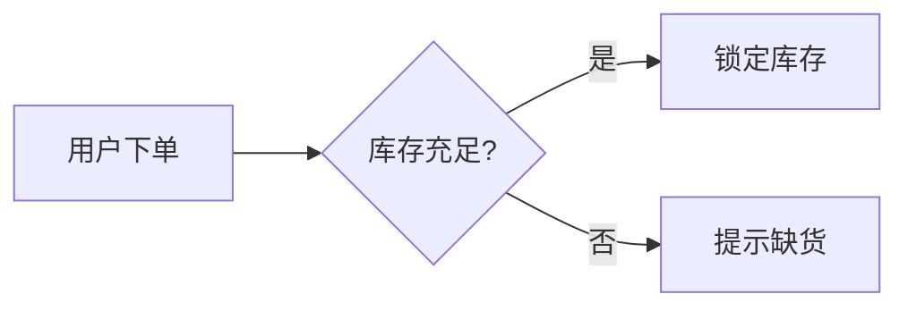

<!-- 由 scripts/sync.mjs 从主仓库 guide/ 生成，不要手改 -->

# 图表（Mermaid）

Mermaid 是用几行文字描述一张图的写法，GitHub、GitLab、语雀等很多地方都认。Marlin 打开文档时直接把它画出来，样式跟着当前主题走。

````markdown

````

流程图、时序图、类图、状态图、甘特图、饼图、思维导图、旅程图等都能画：

<a class="shot" href="../images/mermaid-kinds.webp" target="_blank"></a>

不熟悉语法也没关系：流程图、时序图、思维导图可以在 [画板](../10-board/) 里拖拽着画；配了 AI 模型的话，还能用一句话让 AI 画。

## 插入一张图

编辑时输入 `/流程图`、`/时序图` 或 `/思维导图`，插入一个模板：

- 实时预览里，插入后留在图表卡片里，上面改源码、下面看图
- 分栏、仅源码里，插入后直接打开画板

## 看图

- 点图，全屏看大图：滚轮缩放、拖动平移，<kbd>+</kbd> <kbd>-</kbd> <kbd>0</kbd> 缩放，<kbd>Esc</kbd> 关

右键图：

<a class="shot" href="../images/mermaid-menu.webp" target="_blank"></a>

- **复制图片**：2 倍清晰度的 PNG，直接贴进微信、飞书、Word
- **复制 SVG**、**保存为 PNG…**
- **在画板里编辑**、**编辑源码**：进入编辑并打开画板，或者光标跳到这张图的源码

## 写源码时的补全

在 mermaid 代码块里打字时，弹出可选的内容，都带中文说明：图的类型、这张图里已有的节点和参与者、关键字、连线和箭头的写法。选了一个箭头，接着弹出另一端可选的节点。

<a class="shot" href="../images/mermaid-complete.webp" target="_blank"></a>

<kbd>↑</kbd> <kbd>↓</kbd> 选，<kbd>Enter</kbd> 确定，<kbd>Esc</kbd> 关掉。

## 写错了怎么办

语法写错时，图不会变成一团红字：

- 保留上一次画成功的图，变淡显示
- 下面一行写着「第几行」、出了什么问题，用中文说明（比如「注释要用 %% 开头，不是 //」）
- 点这行说明，光标跳到出错的那一行
- 常见的错误旁边有「修复」按钮，一点就改好；配了 AI 模型时还有「✦ 让 AI 修」

<a class="shot" href="../images/mermaid-error.webp" target="_blank"></a>

## 大窗口里改

在实时预览的图表卡片上点「⤢ 展开」，在大窗口里改：上面是源码（<kbd>Tab</kbd> 缩进），下面是图，边改边画。<kbd>Ctrl+Enter</kbd> 或「完成」一次写回，编辑器里一次 <kbd>Ctrl+Z</kbd> 就能退回；<kbd>Esc</kbd> 取消，有改动时会先问。

## 单独的图文件

`.mmd`、`.mermaid` 文件整个就是一张图，在 Marlin 里打开直接画出来，编辑、进画板的方式和文档里的图一样，保存后仍是纯 Mermaid 文本。

> <strong class="alert-title" data-kind="tip">提示</strong>
> 画好的图要放进 PPT 或发给别人：在阅读态右键图 →「复制图片」，直接粘贴即可。
